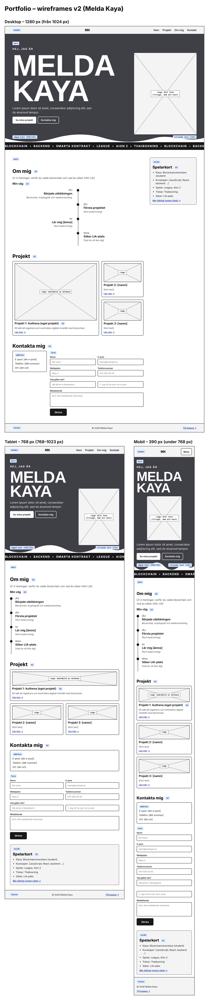

# Melda Kaya | Min portfolio

Hej! Jag heter Melda och pluggar till blockchainutvecklare på Medieinstitutet.

Det här är min portfolio som jag har byggt med HTML och CSS. Jag ville göra en hemsida som både visar vem jag är och fungerar som ett digitalt CV. Tanken är att fortsätta använda den även efter kursen och lägga till fler projekt allt eftersom jag lär mig nya saker.

## Min wireframe

Jag började med att göra en wireframe för att få en bild av hur jag ville att hemsidan skulle se ut. Jag planerade var de olika delarna skulle ligga och hur sidan skulle fungera på mobil, surfplatta och dator.

## Vad jag har använt

- HTML för att bygga upp sidan
- CSS för färger, layout och design
- Flexbox och Grid för att placera innehållet
- Media queries för att anpassa sidan till olika skärmstorlekar
- Git och GitHub för att spara och hålla koll på ändringar

## Design

Jag ville ha en ganska enkel och stilren hemsida, men ändå få med lite av min personlighet. Därför valde jag en mörk design med vinröda detaljer och lite inspiration från gaming.

Jag har också lagt tid på att få sidan att se bra ut på både mobil och dator. Vissa delar behövde ändras för mindre skärmar så att bilder, text och menyer inte hamnade konstigt.

## Tillgänglighet och tester

Jag har försökt göra sidan så enkel som möjligt att använda. Bland annat genom tydliga rubriker, alt-texter på bilder, bra kontraster och en meny som går att använda med tangentbord.

För att se om något behövde förbättras testade jag sidan med W3C Validator och Google Lighthouse.

Mina resultat:

- HTML: 0 fel och 0 varningar
- CSS: 0 fel och 3 varningar
- Lighthouse: 99–100 poäng i mina tester

## Mina projekt

Just nu finns tre projektplatser på hemsidan. Ett av projekten är Authena, en egen idé jag arbetat med inom blockchain. De andra två är platser för framtida projekt.

## Vad jag vill göra framöver

Jag är fortfarande i början av min utbildning, så det finns mycket kvar att lära sig. Jag vill fortsätta förbättra hemsidan, lägga till fler projekt och utveckla den i takt med att jag blir bättre på programmering.
